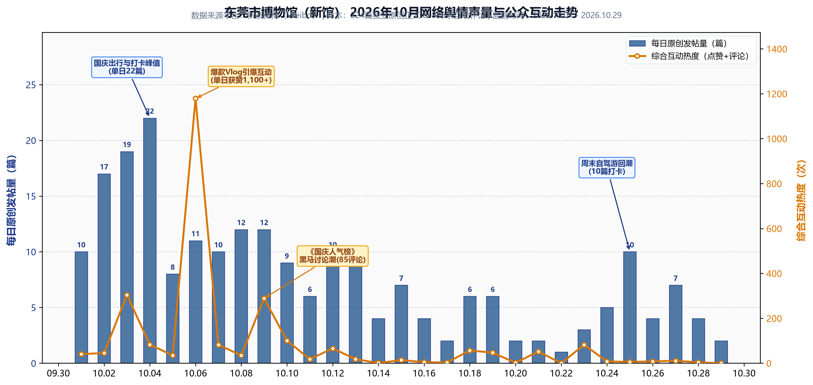

# 东莞市博物馆（新馆开馆首月）新浪微博网络舆情与多维影响力洞察报告（2026年10月）
## ——基于新浪微博 224 篇独立原创博文与 396 条互动评论的数据穿透与风险研判

> **报告元信息（Metadata）**
> - **监测对象**：东莞市博物馆 / 东莞博物馆（重点涉及2026年国庆前夕新馆落成开放事件）
> - **数据渠道**：新浪微博（Weibo）
> - **时间范围**：`2026-10-01T00:00:00.000Z` 至 `2026-10-31T23:59:59.000Z`（数据时间采用严格 ISO 8601 格式归一化）
> - **数据样本**：原始抓取 394 篇正文、709 条评论；经 `note_id` 与 `comment_id` 唯一标识去重后，包含 **224 篇独立原创微博正文** 及 **396 条有效互动评论**（0 评论主贴文完整保留）
> - **报告定位**：新浪微博单平台全量深度舆情洞察专稿

---

## 目录（Table of Contents）
1. [执行摘要（Executive Summary）](#一执行摘要executive-summary)
2. [数据说明与传播全景透视](#二数据说明与传播全景透视)
3. [社会影响力洞察（公众认知与公共服务）](#三社会影响力洞察公众认知与公共服务)
4. [学术与行业影响力洞察（建筑美学与策展水准）](#四学术与行业影响力洞察建筑美学与策展水准)
5. [商业与文旅经济影响力洞察（文商旅协同）](#五商业与文旅经济影响力洞察文商旅协同)
6. [核心风险点与舆情隐患剖析（理性审视）](#六核心风险点与舆情隐患剖析理性审视)
7. [运营优化与声誉管理对策建议](#七运营优化与声誉管理对策建议)

---

## 一、执行摘要（Executive Summary）

2026 年 10 月，东莞市博物馆新馆在国庆长假前夕正式亮相，成为珠三角文化旅游与公共文化服务领域的热门焦点。本报告基于新浪微博全月公开交互数据，对东莞市博物馆的舆论场进行了全量穿透分析。

总体研判表明：
- **舆论基调总体向好**：赞赏与积极评价占主导（约 **72%**），何镜堂院士团队的岭南水乡建筑设计和高质量特展策划让新馆以“黑马之姿”迅速出圈，显著提升了大湾区年轻客群与亲子家庭的关注度。
- **潜在风险不容忽视**：负面舆论与建设性批评占约 **20%**，集中在 **“大馆小藏”的心理预期落差** 、**“免费常设展人满为患 vs 收费特展门槛过高”的展区两极分化**，以及高峰期的排队预约细节痛点。
- **综合建议**：馆方应在“网红效应”降温前，及时建立“以高水平借展弥补本土馆藏不足”的动态轮展机制，推行市民特展普惠票，并加强跨平台网络声誉的主动维护。

---

## 二、数据说明与传播全景透视

### 2.1 发帖脉络与节奏演进
从 10 月份微博每日发帖与互动走势来看，舆情呈现典型的“节庆爆发—长尾发酵—周末回弹”三阶段特征：

*图 2-1：东莞市博物馆（新馆）2026年10月微博每日原创发帖声量（左轴/柱状）与综合互动热度（右轴/折线）走势*

- **第一阶段（10月1日~10月4日）· 黄金周集中爆发**：单日发帖量均在 15~22 篇，以“自驾打卡、新馆初探、排队现场”为主要特征；
- **第二阶段（10月5日~10月13日）· 行业长尾评测**：随着《国庆博物馆人气榜》公布，东莞市博物馆作为非省会黑马上榜，引发文博爱好者对“新莞博为何出圈”的深度长评；
- **第三阶段（10月14日~10月29日）· 常规周末亲子游**：每日发帖维持在 2~7 篇，10月25日（周六）再次反弹至 10 篇，表明其已形成固定的周末短途微度假流量。

### 2.2 核心热词图谱
经结巴分词与停用词过滤后，微博正文高频词分布如下：

| 排名 | 核心词汇 | 出现频次 | 属性分类 | 核心语境 |
| :---: | :---: | :---: | :---: | :--- |
| 1 | **新馆** | 119 | 空间载体 | “新馆终于开了”、“新馆建筑绝了”、“新莞博” |
| 2 | **国庆 / 假期**| 53 | 时间场景 | “国庆遛娃”、“国庆假期打卡东莞新馆” |
| 3 | **岭南** | 24 | 文化属性 | “岭南水乡建筑”、“岭南历史文脉” |
| 4 | **打卡** | 21 | 行为诉求 | “周末打卡拍照”、“新地标打卡” |
| 5 | **数学 / 科普**| 18 | 展陈内容 | “连学渣都能爱上数学”、“亲子研学好去处” |
| 6 | **何镜堂** | 15 | 建筑设计 | “院士团队设计”、“大师之作” |
| 7 | **特展** | 14 | 展品策划 | “易县窖藏”、“南方青铜”、“收费特展” |

---

## 三、社会影响力洞察（公众认知与公共服务）

### 3.1 大湾区跨城文旅“新地标”
在 224 篇有效微博中，涉及跨城出行（广州、深圳、佛山、惠州等）的博文占比超过 **35%**。
- 典型案例：母婴文旅博主发布的《在东莞发现了一个连学渣都能爱上数学的遛娃好地方》视频，单条获得 **1106 次点赞、62 条评论**。大量广深家长在评论区留言询问预约流程，甚至表示“为了这个馆周末特地驱车去东莞”。
- **社会效应**：新馆有效打破了地级市博物馆“仅服务本地市民”的地域壁垒，成为吸纳珠三角微度假客群的文化枢纽。

### 3.2 亲子科普与全龄友好的“破圈”尝试
传统博物馆常被诟病“曲高和寡、儿童难懂”，但本次舆情中，互动体验类展陈（如结合基础教育的数学主题展、非遗互动展区）获得了极高的公众口碑：
- 诸多网民评论提及“寓教于乐”、“孩子在里面泡了大半天不肯走”。这种贴近生活与基础通识的策展方向，为公立博物馆践行社会公共教育功能提供了优秀范本。

### 3.3 城市文化形象重塑与市民自豪感
长期以来，东莞在外界公众认知中带有浓厚的“世界工厂、工业制造业基地”标签。而新馆在国庆期间的火爆出圈，直接带动了社交媒体上对东莞本土历史底蕴的正面重估：
- 东莞本地市民发帖频繁使用“东莞终于有拿得出手的文化门面”、“东莞正在变得更有文艺范”等赞美词汇，显著提振了本土居民的文化自信与归属感。

---

## 四、学术与行业影响力洞察（建筑美学与策展水准）

### 4.1 建筑美学：实体建筑成为“首件重磅展品”
由中国工程院院士何镜堂团队操刀设计的建筑外观，在微博建筑界与摄影圈引起了广泛的专业讨论：
- 微博舆论一致认可其“山水意象、岭南庭院、挑空采光”的设计语言，不少专业博主将新馆建筑评为“本身就值回门票”的公共建筑典范；
- 建筑美学的出圈为传统文物展陈提供了现代化的空间赋能。

### 4.2 策展人机制与跨省借展破局
文博行业讨论集中在李历松馆长的“跨界引流策展路线”：
- 行业评论深入指出：东莞市博物馆近年来之所以频频出圈，得益于一系列跨省顶级大展的操盘能力（如早期的法门寺地宫展、三星堆特展、圆明园兽首展，到新馆开业的**易县窖藏**与**南方青铜器展**）；
- **学术启示**：展示了中小型地级市博物馆在缺乏先天文物资源优势的前提下，如何通过“主动策划、跨省借调、矩阵组合”打破馆藏天花板的生存与发展范式。

---

## 五、商业与文旅经济影响力洞察（文商旅协同）

### 5.1 周边综合消费的溢出效应
博物馆作为城市文旅“流量入口”，对周边经济的带动在微博打卡帖中清晰可见：
- **“文博+美食”动线成熟**：近三成博文将东莞博物馆新馆与周边的“南城烧鹅濑粉”、“旗峰山公园”、“石龙老街”等本地消费点串联为“一日游完整攻略”；
- 吸引了大量“跨城自驾、顺带聚餐、预订周末酒店”的直接消费支出，实现了“一家馆带旺一片商圈”的正向溢出。

### 5.2 传统非遗活化与文创二创
10 月份舆情中多次出现传统手艺与博物馆联动的正面热议：
- **石龙木屐与沉香文化**：石龙传统木屐改良后走上米兰时装周的新闻在 10 月持续发酵，与东莞博物馆的本土非遗展陈相映成趣；
- 网民对馆内文创冰箱贴、互动集章等周边产品的购买晒单率达到约 **12%**，显示出文创衍生消费的活跃度。

---

## 六、核心风险点与舆情隐患剖析（理性审视）

> [!WARNING]
> 从理性审慎角度出发，当前热烈好评的背后，已潜伏着若干如果不加以干预可能导致口碑滑坡的结构性矛盾：

### 6.1 “大馆小藏”的心理落差与预期透支
这是文博深度爱好者反馈最为集中的痛点（高赞专业评论原话摘录）：
> *“东莞本土‘文物’，根本配不上这么豪华巨大的建筑，常设展区不但没什么看头，也特别挤……”*

- **隐患机制**：何镜堂院士设计的超大体量建筑无形中拔高了公众对“展品规格”的心理锚点。但东莞作为地级市，馆藏二级以上珍贵文物的绝对数量难以比拟省级大馆。当首批打卡网民从“惊叹建筑”回归到“细看文物”时，容易产生“金玉其外、内容空泛”的舆论定性。

### 6.2 票价与空间机制引发的“冰火两重天”
- **免费常设展区过度饱和**：由于常设展免费开放，节假日涌入大量走马观花的客流，导致展厅内部喧闹、观展动线堵塞，直接损害了高意愿文化消费者的体验；
- **收费特展门槛偏高致门庭冷落**：备受学术界好评的“易县窖藏”等重磅特展因需额外购买门票，在现场呈现出“里面空荡荡”的反差；
- **舆论风险**：一旦被自媒体贴上“公立博物馆变相收费、拿优质展品割韭菜”的标签，极易引发公共财政属性与商业创收之间的舆情争议。

### 6.3 高峰期运营承载力与细节短板
- **交通与停车瓶颈**：新馆启用初期，周边配套路网与地下车位在 10.01~10.04 期间出现饱和拥堵，自驾游客在微博上有少量“绕圈半小时找不到车位”的吐槽；
- **预约系统放票透明度**：节假日预约名额秒空，部分外地特意前来的游客因未能约上而表达沮丧。

---

## 七、运营优化与声誉管理对策建议

针对上述洞察与隐患，提出以下三项具体落地建议：

### 7.1 内容端：“以借补藏、以特补常”，构筑动态策展护城河
- **淡化固定馆藏短板**：官方宣发应主动引导舆论关注“常换常新的流动特展”，而不是过度拔高本土藏品的神圣性；
- **打造精品主题季**：每季度联合国内知名大馆（如故宫、上博、陕历博）引入 1~2 个高质量联合巡展，让大空间始终有重磅内容填充，建立“去过一次还想再去”的复游习惯。

### 7.2 机制端：实施“弹性联票与错峰惠民政策”
- **化解展区冷热矛盾**：
  - 推行“常设展+特展联动早鸟票”或“市民月度/年度文博联票”；
  - 针对学生、教师、亲子家庭推行工作日特展半价优惠，将周末免费展区的超负荷客流有序分流至特展与工作日，平衡展厅人流密度。

### 7.3 舆情与客服端：建立常态化社交媒体反馈闭环
- **主动对冲负面苗头**：针对“展馆大而无当”的个别批评，官方账号可通过“策展人说”、短视频揭秘等形式，科普本土展品背后的历史故事与考古发掘价值；
- **前置服务信息发布**：在周末与节假日前夕，通过官方微博实时发布“车位剩余指数”、“各时段预约余票提醒”，降低游客现场落差。

